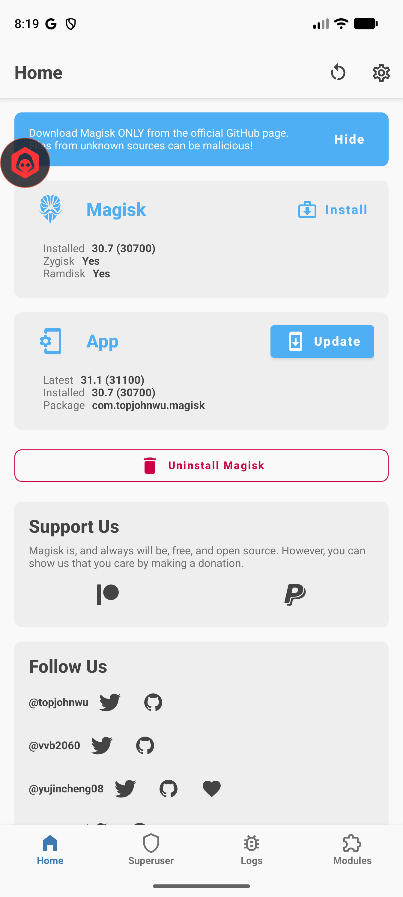
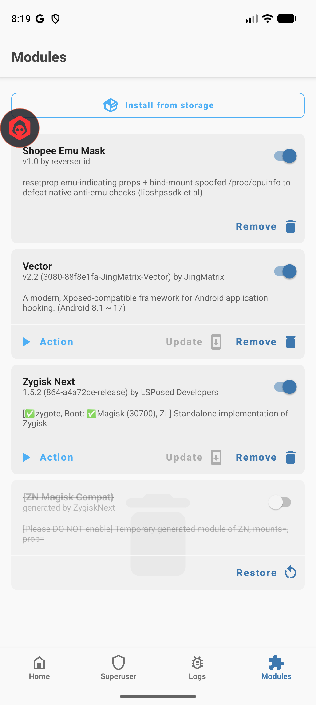
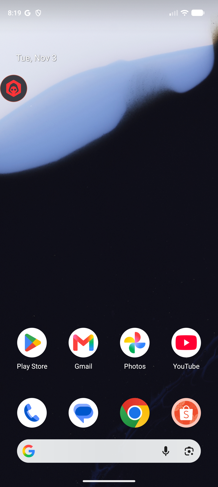
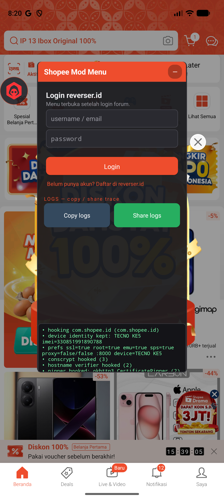

# Setup Shopee Patched di Android Emulator — End-to-End

Dokumen ini jelasin cara setup Shopee patched + modmenu dari **nol** di Android
emulator, **tanpa Android Studio GUI**, **tanpa manual tap-tap Magisk**. Target:
Windows / macOS / Linux. Flow full automated via script Python 3.8+.

- **Script automation**: [`scripts/setup-shopee-emulator.py`](../scripts/setup-shopee-emulator.py)
- **Yang di-setup**: Android SDK (headless) → AVD Pixel 7 → ramdisk patched Magisk
  (headless, no GUI) → emu_mask Magisk module → LSPosed/Vector framework →
  Shopee patched + modmenu + gmsfix
- **Durasi**: ~15 menit full fresh install (SDK download ~2 GB, system image ~1
  GB, boot pertama ~3 menit)
- **Disk**: ~6 GB total (SDK 2 GB + sysimg 1 GB + AVD disk 2 GB + cache 500 MB)

## TL;DR

```sh
# Download script
curl -LO https://github.com/ReverserID/shopee-lite-patched/raw/main/scripts/setup-shopee-emulator.py

# Jalanin (Python 3.8+ required)
python3 setup-shopee-emulator.py

# Done. AVD boot otomatis, Shopee + modmenu ready. Buka emulator window.
```

Script idempotent — aman di-rerun. State checkpoint ada di `~/.shupi-setup/state.json`.
Mau reset full? `python3 setup-shopee-emulator.py --reset` lalu rerun.

## Prerequisites

| Item | Minimum | Catatan |
|---|---|---|
| OS | Windows 10+ / macOS 11+ / Linux glibc 2.31+ | Mac Apple Silicon support (arm64 syskimg autodetect) |
| Python | 3.8+ | Built-in Mac/Linux. Windows: install dari python.org atau Microsoft Store |
| RAM free | 8 GB | Emulator pakai 4 GB |
| Disk free | 10 GB | Install location default `~/android-sdk-shopee` |
| Internet | ~3 GB download | SDK + system image + Magisk + Shopee + modules |
| Virtualization | VT-x / AMD-V / Hypervisor.framework | Harus enable di BIOS (Intel) / Mac punya native. Linux: `/dev/kvm` accessible |

### Verify prerequisites

```sh
# Python
python3 --version   # harus >= 3.8

# Virtualization (Mac/Linux)
# Mac: System Information → Hardware → "Virtualization" = Yes
# Linux: lsmod | grep kvm   # harus ada kvm_intel atau kvm_amd

# Windows: run as admin
systeminfo | findstr /i "Hyper-V Virtualization"
# Harus "Virtualization Enabled In Firmware: Yes"
```

## Full Pipeline

Script bagi jadi 5 phase. Masing-masing bisa dijalanin solo:

```sh
python3 setup-shopee-emulator.py --phase sdk      # Phase 1: Android SDK
python3 setup-shopee-emulator.py --phase avd      # Phase 2: AVD creation
python3 setup-shopee-emulator.py --phase magisk   # Phase 3: Magisk ramdisk patch
python3 setup-shopee-emulator.py --phase apps     # Phase 4: install stack
python3 setup-shopee-emulator.py --phase launch   # Phase 5: launch Shopee
python3 setup-shopee-emulator.py                  # all phases
```

### Phase 1 — Android SDK (download headless, no Android Studio)

Google kasih **commandline-tools** terpisah dari Android Studio. Script:

1. Deteksi OS → download URL commandline-tools yang cocok dari dl.google.com
2. Extract ke `~/android-sdk-shopee/cmdline-tools/latest/`
3. `sdkmanager --licenses` auto-accept (feed `y\n` 20x)
4. `sdkmanager --install platform-tools emulator platforms;android-34 system-images;android-34;google_apis_playstore;x86_64`

**Download size**: ~2 GB (platform-tools 50 MB + emulator 350 MB + system image 1.5 GB + extras)

**Durasi**: 5-10 menit tergantung internet

### Phase 2 — AVD creation

Bikin device Pixel 7 pakai `avdmanager create`:

```sh
# Setara dengan yang di-generate script:
avdmanager create avd \
  -n ShopeeAVD \
  -k "system-images;android-34;google_apis_playstore;x86_64" \
  -d "pixel_7" --force
```

Script auto-tweak `config.ini`:
- RAM: 4 GB
- VM heap: 512 MB
- Disk: 8 GB
- SD card: 2 GB
- GPU: auto (hardware accel)

### Phase 3 — Magisk ramdisk patch (HEADLESS, no GUI)

**Tanpa boot emulator dulu**. Script:

1. Download Magisk APK (release v27.0 dari GitHub)
2. Extract native binary dari dalam APK: `lib/<host-abi>/libmagiskboot.so`, `libmagiskinit.so`, `libmagisk32.so`, `libmagisk64.so`, `libbusybox.so` → rename jadi `magiskboot`, `magiskinit`, dll (ini binary ELF yang jalan di host OS, bukan di Android)
3. Backup `~/android-sdk-shopee/system-images/.../ramdisk.img` → `ramdisk.img.orig`
4. Jalanin `magiskboot cpio ramdisk.cpio add 0750 init magiskinit` + command lainnya untuk inject Magisk init ke dalam ramdisk cpio
5. Replace ramdisk.img dengan versi patched

**Kuncinya**: Magisk's `magiskboot` CLI punya mode untuk langsung patch cpio
(bukan boot.img), jadi gak butuh wrap-and-pack hack. AVD boot system punya
ramdisk standalone yang di-mount sebagai initramfs → inject magiskinit sebagai
`/init` → saat boot, Magisk ambil alih init process → root tersedia.

**Keuntungan vs GUI method**:
- Nggak perlu Magisk Manager APK di-install dulu (circular dependency)
- Nggak perlu fakeboot.img hack
- Fully scriptable, bisa CI/CD

### Phase 4 — Boot AVD + install stack

Script start emulator dengan flag yang penting:

```sh
emulator -avd ShopeeAVD -no-snapshot-load -writable-system -no-boot-anim
```

- `-no-snapshot-load`: cold boot (pakai ramdisk patched kita, bukan snapshot cached yang bebas Magisk)
- `-writable-system`: /system writable buat Magisk overlay
- `-no-boot-anim`: skip animasi, speed up boot

Tunggu `getprop sys.boot_completed == 1`, baru install stack:

1. **Magisk Manager APK** (`com.topjohnwu.magisk`) — buat UI management modules
2. **Shopee patched** — Shopee Indonesia dari release repo
3. **shopee-modmenu v1.7.0** — Xposed module (install, enable via LSPosed setelah reboot)
4. **shopee-gmsfix v1.0.0** — Google login fix (install, enable via LSPosed)
5. **LSPosed/Vector zip** — push via adb → `magisk --install-module`
6. **shopee-emu-mask zip** — push via adb → `magisk --install-module`

Reboot setelah install → modules aktif.

### Phase 5 — Launch Shopee

Script fire `am start Shopee → launcher activity`. Mod menu overlay auto-show (ball
floating di kiri atas).

## Screenshots — state yang di-expect setelah selesai

### 1. Magisk app home — rooted ✓

Setelah boot, buka Magisk Manager → **Magisk 30.7**, **Zygisk Yes**, **Ramdisk Yes**:



Kalau Zygisk/Ramdisk `No` → phase 3 fail, cek `~/.shupi-setup/state.json` + rerun.

### 2. Magisk modules — 3 enabled ✓

Tab Modules → **Shopee Emu Mask** + **Vector** + **Zygisk Next** semua toggle ON:



- **Shopee Emu Mask v1.0** — resetprop ro.kernel.qemu + /proc/cpuinfo bind-mount
- **Vector v2.2** (JingMatrix) — LSPosed framework
- **Zygisk Next v1.5.2** (LSPosed Developers) — standalone Zygisk, support Magisk 30 + mapped Root

### 3. Shopee home — logged in + real server content ✓


Yang muncul:
- Search bar aktif (hint: "Samsung Official Store Indonesia" = search suggestion server)
- ShopeePay, Klaim Koin, SPayLater tiles (campaign aktif)
- Promo "DISKON DAHSYAT 100% PAKAI SEKARANG" (server-driven)
- Shopee Mall carousel, cart badge "1"
- Bottom tab: Beranda / Deals / Live & Video (badge "Baru") / Notifikasi (12) / Saya

Semua content = REAL dari server Shopee (bukan skeleton placeholder). Artinya sign
token valid, server accept semua request. **Kalau cuma skeleton + loading** = v1.6.4
install salah, upgrade ke v1.7.0.

### 4. Mod menu overlay — floating ball visible ✓

Mod menu ball (ikon hexagon merah) tetap visible di kiri atas across SEMUA app
(Shopee, launcher, Magisk, dll):



Overlay persistent karena punya `SYSTEM_ALERT_WINDOW` permission.

### 5. Mod menu panel — opened ✓

Tap ball → panel kebuka:



Panel pertama kali tampil: **Login reverser.id** gate. Semua toggle (SSL unpin, Hide
root, Emu bypass, SPS bypass, dll) terkunci sampai user login forum (free register
di reverser.id). Login gating = anti-abuse (akun yg bagi/jual trade dapet log trace
untuk evidence).

LOGS pane di bawah menampilkan live hook trace:
```
• hooking com.shopee.id (com.shopee.id)
• device identity kept: TECNO KE5 imei=330851991890788
• prefs ssl=true root=true emu=true sps=true proxy=false/false :8000 device=TECNO KE5
• conscrypt hooked (3)
• hostname verifier hooked (2)
```

Setelah login forum, semua toggle unlock + extra sections (TRACKERS, PROXY, DEVICE
rotate, LOGS copy/share) muncul.

## Verify end-to-end

Setelah phase 5, check:

```sh
# Pastikan emulator up + Shopee alive
adb devices
adb shell "pidof com.shopee.id"       # harus ada PID
adb shell "pidof com.topjohnwu.magisk" # harus ada PID (kalau Magisk app lagi dibuka)

# Hook trace (butuh root + Vector CLI)
adb shell "su -c '/data/adb/lspd/cli log cat 2>&1 | grep ShopeeMod | tail -10'"
# Expected output:
# ShopeeMod: hooking com.shopee.id (com.shopee.id)
# ShopeeMod: device identity kept: TECNO KE5
# ShopeeMod: ball: logo loaded
# ShopeeMod: overlay shown
# ShopeeMod: TrustManagers swapped (naive)
# ShopeeMod: tracker blocked: ... (jika trackerBlock=true)

# Emu mask aktif
adb shell "getprop ro.hardware"       # harus "qcom" (bukan "ranchu")
adb shell "getprop ro.kernel.qemu"    # harus "0" (bukan "1")
adb shell "su -c 'mount | grep cpuinfo'"
# Expected: /dev/block/dm-X on /proc/cpuinfo type ext4 ...
```

## Troubleshooting

### `python3: command not found` di Windows

Install Python dari Microsoft Store ("Python 3.12") atau python.org. Kalau pakai
`py.exe`:

```sh
py -3 setup-shopee-emulator.py
```

### `KVM not available` (Linux)

```sh
# Enable KVM module
sudo modprobe kvm
sudo modprobe kvm_intel     # Intel CPU
# atau kvm_amd buat AMD

# Pastikan user masuk group kvm
sudo usermod -aG kvm $USER
# Logout + login ulang
```

### `HAXM is required but no HAXM installer bundled` (Windows)

Modern Windows pakai **WHPX** (Windows Hypervisor Platform), bukan HAXM. Enable:

1. Settings → Apps → Optional features → More Windows features
2. Centang **Windows Hypervisor Platform** + **Virtual Machine Platform**
3. Reboot

### Emulator stuck di bootanim 5+ menit

Kemungkinan ramdisk patch rusak. Rerun phase 3:

```sh
python3 setup-shopee-emulator.py --phase magisk
python3 setup-shopee-emulator.py --phase apps     # reboot + reinstall
```

Atau reset full:

```sh
python3 setup-shopee-emulator.py --reset
python3 setup-shopee-emulator.py
```

### `adb: more than one device/emulator`

Kalau punya device fisik + emu, specify device:

```sh
adb -s emulator-5554 shell ...
# atau unset wireless debug di device fisik
```

### Shopee crash saat buka / "tidak ada internet"

Pastikan modmenu versi **≥ v1.7.0**. v1.6.4 bug nge-block libshpssdk → sign
token kosong → server reject. Update:

```sh
cd ~/.shupi-setup
rm shopee-modmenu.apk        # paksa redownload
python3 setup-shopee-emulator.py --phase apps
```

### Google Login button gak respond

Pastikan `shopee-gmsfix` installed + LSPosed scope mencakup **com.google.android.gms**:

```sh
# Via Vector CLI
adb shell "su -c '/data/adb/lspd/cli modules enable id.reverser.shopee.gmsfix'"
adb shell "su -c '/data/adb/lspd/cli scope set id.reverser.shopee.gmsfix com.google.android.gms/0'"
adb shell reboot
```

Alternatif (emu non-GApps): pakai [`scripts/install-microg.sh`](../scripts/install-microg.sh)
untuk install microG stack. Guide: lihat [FEATURES_ROADMAP.md § MicroG](../FEATURES_ROADMAP.md#alternative-google-login--microg).

### Hook trace kosong di `lspd/cli log cat`

Vector framework belum attach ke Shopee process. Re-enable scope:

```sh
adb shell "su -c '/data/adb/lspd/cli modules enable id.reverser.modmenu'"
adb shell "su -c '/data/adb/lspd/cli scope set id.reverser.modmenu com.shopee.id/0'"
adb shell "am force-stop com.shopee.id"
adb shell "monkey -p com.shopee.id -c android.intent.category.LAUNCHER 1"
```

## Advanced: skip phases

Kalau udah punya Android Studio + AVD existing, skip phase 1-2:

```sh
# Set env ke SDK existing
export ANDROID_HOME=~/Library/Android/sdk      # macOS
export ANDROID_HOME=~/Android/Sdk              # Linux
export ANDROID_HOME="$LOCALAPPDATA/Android/Sdk"  # Windows (PowerShell)

python3 setup-shopee-emulator.py --skip-sdk --skip-avd
# Lanjut dari phase 3 (Magisk patch)
```

Script akan auto-use `ANDROID_HOME` kalau di-set. Patch ramdisk-nya system-image
yang kamu pilih (sesuaikan `AVD_SYSIMG` constant di top script).

## Yang di-automate vs yang manual

| Step | Automated | Manual (kalau script fail) |
|---|---|---|
| Download SDK | ✅ `sdkmanager install` | Install Android Studio + buka SDK Manager GUI |
| Accept licenses | ✅ feed `y` 20x | GUI "Accept all" |
| Create AVD | ✅ `avdmanager create` | AVD Manager GUI (Device Manager) |
| Patch ramdisk | ✅ `magiskboot cpio` headless | Magisk Manager APK → "Install from Image" |
| Install LSPosed | ✅ `magisk --install-module <zip>` | Magisk Manager → Modules → Install from storage |
| Enable Xposed scope | ✅ `/data/adb/lspd/cli scope set` | LSPosed Manager GUI → Modules → Shopee Mod Menu → Scope |
| Install Shopee | ✅ `adb install -r` | Drag-drop APK ke emulator window |

Script bisa jalan **tanpa buka UI Android sama sekali**. Satu-satunya step yg butuh
UI user: tap ball + login forum reverser.id (anti-abuse gate).

## Lifecycle commands

```sh
# Lihat state
cat ~/.shupi-setup/state.json

# Reset state checkpoint (next rerun akan rerun semua phase)
python3 setup-shopee-emulator.py --reset

# Uninstall full
rm -rf ~/android-sdk-shopee ~/.shupi-setup ~/.android/avd/ShopeeAVD.avd ~/.android/avd/ShopeeAVD.ini

# Start/stop emu tanpa script
~/android-sdk-shopee/emulator/emulator -avd ShopeeAVD -no-snapshot-load &
~/android-sdk-shopee/platform-tools/adb emu kill
```

## References

- Android SDK commandline-tools: https://developer.android.com/studio#command-tools
- Magisk v27 release: https://github.com/topjohnwu/Magisk/releases/tag/v27.0
- magiskboot CLI reference: https://github.com/topjohnwu/Magisk/blob/master/docs/tools.md
- LSPosed/Vector (JingMatrix fork): https://github.com/JingMatrix/LSPosed
- rootAVD (reference impl, GUI-less Magisk patch untuk AVD): https://gitlab.com/newbit/rootAVD
- Shopee patched release: https://github.com/ReverserID/shopee-lite-patched
- Forum thread + support: https://reverser.id/d/54

## Changelog dokumen

- **v1.0 (2025-11-03)** — initial comprehensive guide, 6 screenshots, 5-phase pipeline
